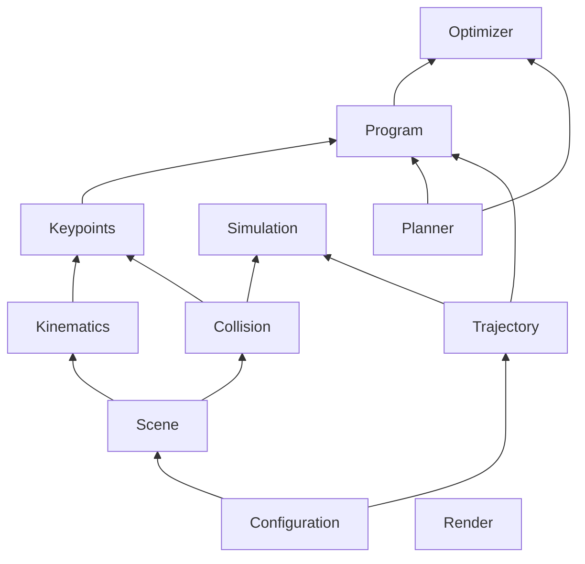
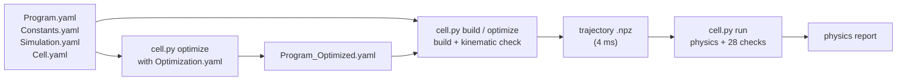
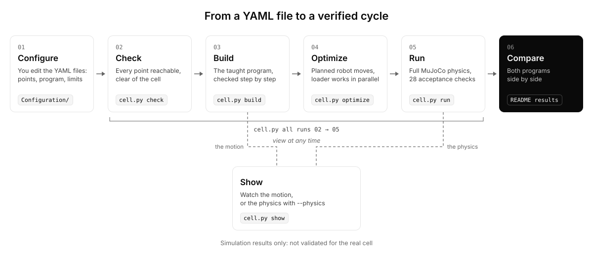

# Test-it-off Simulation – Automated PCBA Testing Cell in MuJoCo

<p align="center">
  <picture>
    <source media="(prefers-color-scheme: dark)" srcset="Media/JIC_Smart_Factory_White.svg">
    
  </picture>
  &nbsp;&nbsp;&nbsp;&nbsp;
  <a href="https://www.kinali.cz/en/">
    <picture>
      <source media="(prefers-color-scheme: dark)" srcset="Media/KINALI_White.svg">
      
    </picture>
  </a>
</p>

A MuJoCo simulation of [KINALI](https://www.kinali.cz/en/)'s [Test-it-off](https://www.testitoff.cz/en/) PCBA test cell
in which a robot program for the whole process can be written, checked kinematically, run with full physics and compared
before it is run anywhere else.

[](LICENSE)


<p align="center">
  
</p>

**Figure 1:** The Default program (left) and the Optimized program (right) running the same cycle in physics, at 4 x speed.
The Optimized program finishes first. The media show the v1.0 programs. Simulation results.

> [!WARNING]
> **Outputs of this project (keypoints, programs, trajectories) are simulation results and are NOT validated for driving the real cell.** Before any use on real hardware they must go through the real-cell validation procedure (to be defined), with reduced speed and the robot controller's own safety limits active.

## Contents

[Quick start](#quick-start) · [Results](#results) · [Change the key points](#change-the-key-points) · [Files](#files) ·
[About](#about) · [What the cell does](#what-the-cell-does) ·
[Collision structure](#collision-structure) · [Architecture](#architecture) · [Usage](#usage) ·
[The v1.0 comparison](#the-v10-comparison) · [Repository layout](#repository-layout) ·
[Claude Code skills](#claude-code-skills) · [Requirements and platform](#requirements-and-platform) · [Citation](#citation) ·
[License](#license) · [Authors](#authors)

## Quick start

Prerequisite: Python 3.11. macOS (verified, Apple silicon): `brew install python@3.11`. Ubuntu (not verified):
`sudo apt install python3.11 python3.11-venv`.

```bash
git clone https://github.com/rparak/KINALI_Test_it_off_Simulation.git
cd KINALI_Test_it_off_Simulation
./install.sh                             # .venv with Python 3.11 and the pinned requirements
.venv/bin/python Example/cell.py all     # check, build, optimize, run: both programs with physics, about 45 s
.venv/bin/python Example/cell.py show    # the Default program in MuJoCo's viewer
```

`cell.py all` ends with the comparison of both programs:

```text
program               cycle [s]  throughput [PCB/h]  acceptance
Default program          70.404                51.1  28/28 pass
Optimized program        59.148                60.9  28/28 pass
change                  -16.0 %             +19.0 %
[INFO] The physics reports are in Data/Generated/Reports (<program>_physics.txt).
[INFO] Simulation results only: not validated for the real cell.
[INFO] all passed: check, build, optimize, run.
```

On macOS the viewer needs MuJoCo's `mjpython`: `cell.py` re-launches itself under `.venv/bin/mjpython`. Every action is a
subcommand of `Example/cell.py`: `--help` lists them, `<subcommand> --help` gives its options.

## Results

The physics baselines of both programs ([P]: the physics run). `cell.py all --recapture` regenerates this table after an
intended change. Throughput = 3600 s / cycle time. Simulation results.

<!-- results:start -->
| Metric | Default program | Optimized program | Change |
|---|---:|---:|---:|
| Cycle time [s] [P] | 70.404 | 59.148 | −16.0 % |
| Throughput [PCB/h] [P] | 51.1 | 60.9 | +19.0 % |
| Acceptance checks [P] | 28/28 pass | 28/28 pass | equal |
<!-- results:end -->

The media in this README (the GIF previews, the renders and the charts) show the v1.0 programs.

## Change the key points

The robot's named points are in `Configuration/Constants.yaml` (`Points`). A taught point is defined by its `Joints` [deg]. A
derived point names a `Reference` point and an `Offset` [m] from it, and its `Joints` and `Pose` are the resolved values.

1. Edit the point in `Configuration/Constants.yaml`.
2. `.venv/bin/python Example/cell.py point <P>` prints the point's check row and, for a derived point, the corrected `Joints`
   and `Pose` lines: paste them into the point. `--show` opens the viewer on the cell posed at it.
3. `.venv/bin/python Example/cell.py check` checks every point (IK, family, clearance) and that the programs load.
4. `.venv/bin/python Example/cell.py all` rebuilds both programs, runs the optimizer only when its inputs changed, and runs
   the physics against the baselines.

| When this fails | It means | Do |
|---|---|---|
| `check`: a point FAILs | the point is out of reach, in the wrong IK family, too close to the cell, or stale (its `Joints` no longer match its `Reference` and `Offset`) | `cell.py point <P>` names the rule: correct the point, or paste the printed lines |
| `build` or `optimize`: the check fails | a step collides, exceeds a limit or breaks an interlock | the check report names the step and the closest pair: correct the point or the program |
| `run`: an acceptance check FAILs | the physics run breaks one of the 28 checks, for example a contact or a lost PCB | correct the change. `cell.py run --program default` (or `optimized`) prints the full physics report |
| `run`: only a drift FAILs | every check is met, but the physics moved beyond a regression tolerance | if you intended the change: `cell.py all --recapture` |

`cell.py all --recapture` is for a change you intend. It re-captures the kinematic golden (`test/Program/data/`) and the
physics baselines (`test/Simulation/data/`) where they differ, prints what changed, and regenerates the results table above.
Commit them right after the change, on their own, with the reason. It refuses when an acceptance check fails: no baseline may accept a failing check.

## Files

| Kind | Files | How they change |
|---|---|---|
| You edit | `Configuration/Cell.yaml`, `Constants.yaml`, `Simulation.yaml`, `Program.yaml`, `Optimization.yaml` | by hand: nothing writes them |
| Generated by `cell.py` | `Data/Optimized/Program_Optimized.yaml` (`optimize`, committed), the trajectories and reports in `Data/Generated/` and the logs in `logger/` (git-ignored) | `cell.py` writes them again when an input changes |
| Re-captured by `cell.py all --recapture` | the golden `test/Program/data/`, the physics baselines `test/Simulation/data/`, the results block of this README | only after an intended change, never by hand |
| Never edit by hand | `models/` (the scene, the vendored AUBO i5, the tool), `Data/PCB/`, `Data/Paths/` (the recorded fork path), `Media/`, `test/Scene/data/` | the sources and their pins |

## About

An internal research project of JIC Smart Factory, part of its internal research supporting small and medium-sized
enterprises in advanced simulation. Developed in collaboration with KINALI for the development of the
[Test-it-off](https://www.testitoff.cz/en/about-test-it-off/) system, an automated workcell for testing assembled printed
circuit boards (PCBA).

In the Test-it-off cell, an AUBO i5 robot with an OnRobot VGC10 vacuum gripper and a fork takes each PCB from an input
crate and hands it to a two-axis loader, which inserts it into the MG06 test fixture. The robot closes and opens the fixture
with the fork and places the tested PCB into an output crate. This repository models that cell in MuJoCo and provides:

- **Two robot programs for the same process.** The *Default program* is taught as an operator would teach it: named points,
  sequential steps, and the robot and the loader never move at the same time. The *Optimized program* plans its free-space
  moves and runs the loader in parallel under interlocks.
- **Checks at two levels.** Each program is built into a 4 ms trajectory and checked kinematically (exact clearances, joint
  limits, speeds). Its physics run must pass 28 acceptance checks.
- **A measured comparison** of the two programs at v1.0, with figures and videos, every number tagged with its source.

**From CAD to MuJoCo.** The workstation, the MG06 fixture, the loader and the PCB were exported from KINALI's CAD through
Blender into `models/scene.xml` in the predecessor projects (`mg06_loader_mujoco`, `mg06_cell_mujoco`). That scene is
final and is never regenerated. The AUBO i5 comes from [ian-chuang/Manipulator-Mujoco](https://github.com/ian-chuang/Manipulator-Mujoco)
(MIT), the VGC10 with the fork from the MG06 project. `src/Scene/Core.py` assembles the cell at load time with `mujoco.MjSpec`
and changes no file on disk. It adds the tool, mounted rigidly on the flange, one body with a bellows spring and an adhesion
actuator per suction cup, the robot's position servos, the loader's drive lag and the studio look.
`Example/Maintenance/export_cell_scene.py` writes the assembled cell as one file, `models/cell_scene.xml`.

**Collision geometry.** Every part has its own collision set, separate from its visual meshes: simplified and convex-part
meshes in `models/<part>/assets/collision/` and primitives (the crates as a floor and four walls, the PCB as a board box,
two corner strips and one component box, each cup as a square pad of its area). The kinematic checks use a planning model
that adds the table top as two boxes. The physics model has no table.

**Documented CAD deviations.** Three deliberate corrections in `models/scene.xml` make the cycle work in the model: the
loader shifted +100 mm in Y and +0.95 mm in X, the rear-right holder support lowered by 0.8 mm, and the electrical cabinet
200 mm deep instead of 300 mm. They must be checked against the real cell before any transfer.

**Physics and dynamics from the datasheets.** The parameters come from the components' datasheets where a datasheet gives
them. Otherwise, the value is an estimate or an assumption.

The solver runs at a 0.5 ms timestep (Newton solver, elliptic friction cones).

## What the cell does

1. The robot picks the PCB with vacuum from the left (input) crate.
2. It puts the PCB into the open loader jaws. The loader clamps it, the vacuum goes off and the robot leaves.
3. The loader lifts the PCB, moves it to MG06, lowers it into the holder, opens and parks.
4. The robot closes MG06 with the fork (lid down, handle to about 29°), leaves while the board is tested, comes back and
   opens MG06.
5. The loader moves back, re-grips the PCB, lifts it and returns home.
6. The robot takes the PCB from the loader, puts it into the right (output) crate and goes home.

<p align="center">
  
</p>

**Figure 2:** The cell during the handover in the Optimized program (physics run, t = 8.45 s): the robot places the PCB into
the loader's jaws in front of the MG06 tester. Rendered from the simulation model.

<p align="center">
  
</p>

**Figure 3:** The cell posed at every robot point of `Configuration/Constants.yaml`, in program order, with the loader,
jaws, PCB and MG06 in each point's scene. Rendered from the simulation model.

## Collision structure

<details>
<summary><b>Collision structure</b>: the collision geometry and its categories</summary>

<table>
  <tr>
    <td width="50%">
    <p><b>Figure 4:</b> The collision geoms over the visual cell during the handover, the whole cell.</p></td>
    <td width="50%">
    <p><b>Figure 5:</b> The same at the loader handover, close up: the tool, the cups, the PCB and the loader's jaws.</p></td>
  </tr>
</table>

Each collision geom is blended semi-transparently in its category's colour over the rendered visual cell. The categories
and their geom counts, as in the images' legend:

| Category | Colour | Geoms |
|---|---|---:|
| robot | blue | 11 |
| tool: VGC10, fork and cups | bluish green | 22 |
| MG06 | reddish purple | 149 |
| loader: axes, carriages, jaws | vermillion | 140 |
| crates | orange | 10 |
| table boxes (planning model only) | yellow | 2 |
| workstation: frame, pedestal | grey | 8 |
| PCB | sky blue | 4 |

</details>

## Architecture

<details>
<summary><b>Architecture</b>: the domains, the configuration, the data flow, the optimizer and the interlocks</summary>

The code is in `src/`, one folder per domain, each with its primary module `Core.py`. A domain imports only the domains
below it:



<details>
<summary><b>The domains and their roles</b>: what each folder of src/ does</summary>

| Domain | Role |
|---|---|
| Configuration | the only reader of the YAML files, the strict line parser of the cell program |
| Scene | builds the cell from the MJCF files, exports `models/cell_scene.xml` |
| Kinematics | site poses and inverse kinematics on the suction TCP or the flange |
| Collision | exact distances (`mj_geomDistance`), the planning model, the contact categories |
| Render | the passive viewer and its playback loop |
| Trajectory | the 4 ms trajectory file (`.npz` and a CSV export) |
| Keypoints | the named robot points: posing, the point check, IK resolution |
| Program | builds a program into a trajectory and checks it (clearance, limits, interlocks) |
| Planner | RRT-Connect, shortcut, cubic spline and TOPP in joint space, independent of the cell |
| Optimizer | plans the Optimized program's free transfers and writes it |
| Simulation | the physics run of a trajectory, its report and the 28 acceptance checks |

</details>

**The configuration files**, all in `Configuration/` and edited by hand. No tool writes them:

| File | Holds | Who changes it |
|---|---|---|
| `Program.yaml` | the program: segments of robot lines, the loader jobs | the robot programmer |
| `Constants.yaml` | the named values the program uses: points (stored joints), loader positions, gripper commands, signals | the robot programmer |
| `Simulation.yaml` | what only the simulation needs: allowed contacts per step, simulated signal times, the start state | the simulation maintainer |
| `Cell.yaml` | the cell's physical description: robot base, vacuum, clearances, motion limits, acceptance bounds | the simulation maintainer |
| `Optimization.yaml` | the optimizer's settings: FREE segments, seed, margins, exit and waiting points, tilt limit | the simulation maintainer |

`Data/Optimized/Program_Optimized.yaml` is the Optimized program. It is generated by `cell.py optimize` and committed.

**The data flow.** A program becomes a trajectory, the trajectory is run with physics, and the runs feed the reports:



**The optimizer.** `Optimization.yaml` names the FREE segments: the free-space transfers between the process steps. Every
other segment is LOCKED: the picks, the handover, the fork paths at MG06, the take, the place and the loader jobs. A LOCKED
segment is copied unchanged from the Default program and its samples are byte-identical in both programs (only its start time
moves). Each FREE transfer is planned in four steps:

1. **RRT-Connect** in joint space finds a collision-free path (seeded, so the result is reproducible).
2. **Shortcut and prune** remove the detours.
3. **A cubic spline** is fitted through the remaining waypoints and **rechecked** in steps of at most 0.5° per joint, refitted
   where it comes too close.
4. **TOPP** (time-optimal path parametrization by reachability) times the spline within the speed and acceleration limits.

**Interlocks and the gating rule.** The robot and the loader move in parallel only where the program's order makes it safe.
Ten interlocks (I1-I10) are verified on every built trajectory, for example: the handover starts with the loader home and
open (I1), the robot goes to the take only after the loader's Y axis is home (I9), and the insert starts only after the robot
has left the handover (I10). The **gating rule** forbids any parallel part that rests on timing alone: while a loader job may
run, the robot stays at least 10 mm from every pose the job sweeps. The order must come from the program (the robot out of
the way before `Loader.Start`, or `Loader.WaitDone` before the robot moves in), never from a `Wait` or a quick start.

<details>
<summary><b>The ten interlocks</b>: what each one guarantees</summary>

| # | Interlock | Why |
|---|---|---|
| I1 | the handover starts with the loader home and the gripper open | the PCB enters open jaws |
| I2 | `J_INSERT`'s first loader move after the handover ends | the loader moves only after the robot left the jaw zone |
| I3 | MG06 is closed only after `J_PARK`'s last move (parked, gripper open) | the PCB is released and the loader parked |
| I4 | the test starts after the robot has left MG06 (closed, fork out of the bar) | the tester runs closed, the robot away |
| I5 | the robot returns to MG06 only after the test ends | no motion at MG06 during the test |
| I6 | `J_FETCH` starts after MG06 is open and the fork has left the handle | the loader enters MG06 only when it is open |
| I7 | the take starts after `J_RETURN_Z`'s last move (loader home, PCB clamped) | the robot enters the jaw zone only with the loader home |
| I8 | the robot and a carried PCB stay at least 10 + 4 mm from the loader where both may move | parallel motion is safe only where it is checked |
| I9 | the robot's motion to the take starts after `J_RETURN_Y` is done | the loader's Y is home, whatever the loader's speed |
| I10 | `J_INSERT` starts after the robot's motion out of the handover is done | the robot has left, whatever the robot's speed |

</details>

</details>

## Usage

<p align="center">
  <picture>
    <source media="(prefers-color-scheme: dark)" srcset="Media/Architecture_dark.svg">
    
  </picture>
</p>

**Figure 6:** From a YAML file to a verified cycle: each step with its command, `cell.py all` running steps 02 to 05, and
the viewer (`cell.py show`), which can be opened at any time on a built trajectory or, with `--physics`, on its physics run.

Every action is a subcommand of one Python script, run with the repository's interpreter:
`.venv/bin/python Example/cell.py <subcommand>`. `--help` lists the subcommands and `<subcommand> --help` gives the options.
`--program default` is the Default program and `--program optimized` the Optimized one. On macOS the viewer needs
`mjpython` ([Quick start](#quick-start)). `--headless` (`point`, `show`) poses the cell and prints it without a window.
The times are measured on an Apple M2 Pro.

```bash
.venv/bin/python Example/cell.py check                         # every key point (IK, family, clearance), the programs load; writes nothing
.venv/bin/python Example/cell.py point P_INPUT_ABOVE           # one point: its check row, the corrected Joints and Pose lines
.venv/bin/python Example/cell.py point P_INPUT_ABOVE --show    # the cell posed at that point, in the viewer
.venv/bin/python Example/cell.py build                         # the Default program: 4 ms trajectory, kinematic check; about 11 s
.venv/bin/python Example/cell.py optimize                      # the Optimized program and its trajectory; about 70 s
.venv/bin/python Example/cell.py run                           # both programs with physics: 28 checks, drift, comparison; about 21 s
.venv/bin/python Example/cell.py run --program optimized       # one program's full physics report (no baselines)
.venv/bin/python Example/cell.py show                          # play the Default program's trajectory
.venv/bin/python Example/cell.py show --program optimized      # play the Optimized program's trajectory
.venv/bin/python Example/cell.py show --physics --speed 0.25   # the physics run, four times slower than real time
.venv/bin/python Example/cell.py show --step S4_Handover       # pose the end of a step (number or name; trajectory only)
.venv/bin/python Example/cell.py show --time 9.0               # start paused at 9.0 s
.venv/bin/python Example/cell.py all                           # check -> build -> optimize (only when stale) -> run; about 45 s
.venv/bin/python Example/cell.py all --recapture               # after an intended change: golden, baselines, results; about 2.5 min
```

`build` checks every 4 ms sample for clearance, joint limits, speeds and the interlocks. `optimize` plans the free-space
moves and lets the loader work in parallel. `run` runs each trajectory with full physics against the 28 acceptance checks.

**Typical workflows.**

- *The first run:* `./install.sh` -> `all` -> `show`, as in [Quick start](#quick-start).
- *Change a key point:* edit `Configuration/Constants.yaml` -> `point <P>` -> paste the printed `Joints` and `Pose` lines ->
  `check` -> `build` -> `all`. What each failure means: [Change the key points](#change-the-key-points).
- *Accept an intended change:* `all --recapture` -> commit the re-captured files on their own, right after the change, with
  the reason. It refuses a failing acceptance check ([Change the key points](#change-the-key-points)).

**Viewer keys.** The viewer window must have the keyboard focus (click it once). `[` and `]` are MuJoCo's own viewer keys.

| Key | On a Mac keyboard | Trajectory | Physics (`--physics`) |
|---|---|---|---|
| Home | Fn + Left | pause / resume | pause / resume |
| Page Down | Fn + Down | the next step | the next step |
| `.` | `.` | the next step | one sample on |
| Page Up | Fn + Up | the step's start | not available (a physics run goes forward only) |
| End | Fn + Right | the step's end | the step's end |
| `[` / `]` | `[` / `]` | cycle the cameras (`cam_pcb`, `cam_tool`) | the same |

**Exit codes and outputs.** 0 success, 1 a check failed, 2 the action cannot run (a missing or stale input, no viewer).
Outputs go into `Data/Generated/<Kind>/` (git-ignored), the logs into `logger/cell_<subcommand>.log`. The full list is in
[Files](#files).

## The v1.0 comparison

The v1.0 comparison (`d8e3e2a`), measured by that release's comparison tool: **[K]** the kinematic trajectory, **[P]** the
physics run.

| Metric (v1.0) | Default program | Optimized program | Change |
|---|---:|---:|---:|
| TCP arc length [m] [K] | 7.96 | 7.35 | −7.7 % |
| Joint-space arc length [rad] [K] | 32.4 | 27.5 | −15.0 % |
| PCB arc length [m] [K] | 2.71 | 2.86 | +5.5 % |
| Closest robot - loader in a free transfer [mm] [P] | 20.0 | 15.6 | — |
| Closest robot - loader overall, at the take [mm] [P] | 8.30 | 8.30 | equal |
| Largest carried PCB tilt [deg] [P] | 9.0 | 16.8 | — |
| Largest PCB slip in the cups [mm] [P] | 1.30 | 1.31 | — |

The joint-space arc length sums the norm of the six joints' change over the 4 ms samples.

**Key findings.**

- **The gain comes from parallel motion and planned transfers.** The robot moves while the loader inserts, parks, fetches
  and returns the PCB, and the planned splines replace the taught vias. Of the 11.256 s saved, 6.940 s is robot motion and
  4.316 s is robot waiting for the loader. The LOCKED process steps are identical in both programs.
- **No parallel part rests on timing.** Because every parallel part is gated by the program's order, the Optimized program
  keeps I8 for any loader job slowed down up to 2 x and for any robot speed override down to 10 %: the closest robot - loader
  distance stays 29.68 mm. A slower loader or a slower robot only lengthens the cycle.
- **The gate costs 0.432 s.** The robot first moves to its exit point `P_LOADER_WAIT` and only then starts the insert, which
  lengthened the cycle from 58.716 s to 59.148 s (+0.7 %).
- **The longer PCB path is accepted.** The optimization minimizes the cycle time, not the PCB path: the +5.5 % PCB arc comes
  from joint-space planning, the clearance kept around the loader and the larger tilt.

<p align="center">
  <picture>
    <source media="(prefers-color-scheme: dark)" srcset="Media/Default_vs_Optimized_dark.png">
    
  </picture>
</p>

**Figure 7:** Default vs Optimized: the Optimized program relative to the Default program (100 %), with each value and its
change. Throughput = 3600 s / cycle time. All values from the kinematic trajectories [K]. Simulation results.

<p align="center">
  <picture>
    <source media="(prefers-color-scheme: dark)" srcset="Media/Timeline_dark.png">
    
  </picture>
</p>

**Figure 8:** The timeline of every moving object in both programs: who holds the PCB, when the robot moves or waits (hatched
by what it waits for), the loader axes and jaws, MG06, and when the robot or the loader is in a shared zone. In the
Optimized program the loader rows overlap the robot's motion. Kinematic trajectories.

<p align="center">
  
</p>

**Figure 9:** The Optimized program's cycle in physics, Overview_Right view, at 4 x speed.

The full-resolution videos (MP4, H.264, real time) are assets of the
[v1.0 release](https://github.com/rparak/KINALI_Test_it_off_Simulation/releases/tag/v1.0): the two programs side by side
([`Default_vs_Optimized_Side_by_Side.mp4`](https://github.com/rparak/KINALI_Test_it_off_Simulation/releases/download/v1.0/Default_vs_Optimized_Side_by_Side.mp4)), each program in the Overview_Right view
([`Default_Overview_Right_1440p.mp4`](https://github.com/rparak/KINALI_Test_it_off_Simulation/releases/download/v1.0/Default_Overview_Right_1440p.mp4),
[`Optimized_Overview_Right_1440p.mp4`](https://github.com/rparak/KINALI_Test_it_off_Simulation/releases/download/v1.0/Optimized_Overview_Right_1440p.mp4)) and as a 2 x 2 mosaic
([`Default_Mosaic_1440p.mp4`](https://github.com/rparak/KINALI_Test_it_off_Simulation/releases/download/v1.0/Default_Mosaic_1440p.mp4),
[`Optimized_Mosaic_1440p.mp4`](https://github.com/rparak/KINALI_Test_it_off_Simulation/releases/download/v1.0/Optimized_Mosaic_1440p.mp4)).

<details>
<summary><b>The stations close up</b>: the crates, the loader handover and MG06</summary>

<table>
  <tr>
    <td width="50%">
    <p><b>Figure 10:</b> The input crate: the pick with four suction cups.</p></td>
    <td width="50%">
    <p><b>Figure 11:</b> The loader handover: the PCB placed into the open jaws, tilted 8.94° like the cassette.</p></td>
  </tr>
  <tr>
    <td width="50%">
    <p><b>Figure 12:</b> MG06: the loader has released the PCB into the holder, 0.15 mm above its seat.</p></td>
    <td width="50%">
    <p><b>Figure 13:</b> MG06: the fork on the handle bar after closing the fixture, before it leaves for the test.</p></td>
  </tr>
  <tr>
    <td width="50%">
    <p><b>Figure 14:</b> The output crate: the place, the PCB released 1 mm above the floor.</p></td>
    <td width="50%"></td>
  </tr>
</table>

All close views are from the Optimized program's physics run, rendered from the simulation model.

</details>

## Repository layout

<details>
<summary><b>Repository layout</b>: what each folder holds</summary>

```text
Configuration/   the cell (Cell.yaml), the program (Program.yaml, Constants.yaml, Simulation.yaml), the optimizer (Optimization.yaml)
Data/            the PCB poses, the recorded MG06 fork path, the committed Optimized program; Generated/ (git-ignored outputs)
Example/         cell.py, the one command; Cell/ its internal modules; Maintenance/ the regression and scene tools
Media/           the README's images, charts and GIF previews
models/          the MJCF files and meshes: scene.xml, the AUBO i5, the VGC10 with the fork, cell_scene.xml
src/             the library, one folder per domain (see Architecture)
test/            the tests, mirroring src/ and Example/, with the regression baselines in test/<Domain>/data/
install.sh       creates .venv with Python 3.11 and the pinned requirements
.claude/skills/  the Claude Code skills the development follows (see Claude Code skills)
```

</details>

## Claude Code skills

The repository ships the [Claude Code skills](https://code.claude.com/docs/en/skills) its development follows, in
`.claude/skills/`. Claude Code loads them when it is started in this folder.

<details>
<summary>The five skills, their tools and how to use them</summary>

| Skill | What it is for | Its tools |
|---|---|---|
| `project-style-rpx` | the code, YAML, installer and Markdown conventions, and this project's layout, file formats and model rules | `check_style.py` |
| `feature-manager` | how a feature, a behaviour change or a bug fix is made: requirements, the premise checked, a report before building, small commits | - |
| `project-optimize` | behaviour-preserving work (cleanup, speed, complexity, reliability), proven by byte-identical outputs | - |
| `readme-writer` | every change to this README: the source of each number, the figures, the statuses | `check_readme.py`, `render_readme.py` |
| `support-brief` | the brief pasted into a new Claude chat that acts as the project's technical support, created or refreshed from the repository | - |

Claude Code picks a skill by its description, or you name it, for example `/feature-manager <your request>`. The checkers
run on their own: 0 issues and 0 errors are expected, and `check_readme.py` warns about the README's length.

```bash
.venv/bin/python .claude/skills/project-style-rpx/scripts/check_style.py
.venv/bin/python .claude/skills/readme-writer/scripts/check_readme.py README.md
```

The skills' own tests run with the test suite. A personal skill of the same name (`~/.claude/skills/<name>/`) takes
precedence over the repository's copy.

</details>

## Requirements and platform

<details>
<summary><b>Requirements and platform</b>: the platforms, Python and the pinned packages</summary>

- **Platform:** macOS on Apple silicon (verified, Apple M2 Pro) and Ubuntu Linux (installer written, not verified).
- **Python 3.11**, called explicitly by `install.sh` (`/opt/homebrew/bin/python3.11` on macOS, `python3.11` on Linux).
- **Pinned packages** (`requirements.txt`): `mujoco==3.16.0`, `numpy==2.4.6`, `scipy==1.17.1`, `PyYAML==6.0.3`,
  `pytest==9.1.1`, `pytest-xdist==3.8.0`.
- Results are byte-identical for the same inputs on one machine and platform. Across platforms they agree within numeric
  tolerance only.

</details>

## Citation

If you use this project, cite it with the metadata in [CITATION.cff](CITATION.cff). GitHub shows it as *Cite this repository*
on the repository page.

## License

MIT License, Copyright (c) 2026 JIC Smart Factory. See [LICENSE](LICENSE). The Claude Code skills in `.claude/skills/`: MIT
License, Copyright (c) 2026 Roman Parak. See [.claude/skills/LICENSE](.claude/skills/LICENSE).

Third party:

- **AUBO i5 model**: from [ian-chuang/Manipulator-Mujoco](https://github.com/ian-chuang/Manipulator-Mujoco), MIT License
  ([models/aubo_i5/LICENSE_Manipulator-Mujoco](models/aubo_i5/LICENSE_Manipulator-Mujoco)).
- **Vendor datasheets** (AUBO i5, OnRobot VGC10, SCHUNK EGI 040-EI) are cited for the values the model takes from them. They
  are not included in this repository.
- Test-it-off is a product of KINALI and is referenced by name only.

## Authors

<table><tr><td align="center"><a href="https://github.com/rparak"><br /><strong>Roman Parak</strong></a><br />Author</td><td align="center"><a href="https://github.com/LukasMoravansky"><br /><strong>Lukas Moravansky</strong></a><br />Contributor</td></tr></table>
