# Test-it-off Simulation – Automated PCBA Testing Cell in MuJoCo

<p align="center">
  <picture>
    <source media="(prefers-color-scheme: dark)" srcset="Media/JIC_Smart_Factory_White.svg">
    
  </picture>
  &nbsp;&nbsp;&nbsp;&nbsp;
  <a href="https://www.kinali.cz/en/">
    <picture>
      <source media="(prefers-color-scheme: dark)" srcset="Media/KINALI_White.svg">
      
    </picture>
  </a>
</p>

A MuJoCo simulation of [KINALI](https://www.kinali.cz/en/)'s [Test-it-off](https://www.testitoff.cz/en/) PCBA test cell
in which a robot program for the whole process can be written, checked kinematically, run with full physics and compared
before it is run anywhere else.

[](LICENSE)


<p align="center">
  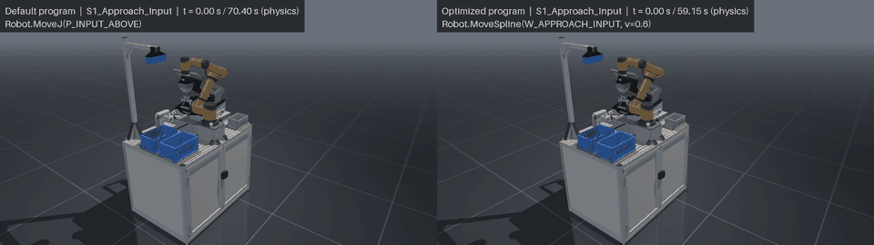
</p>

**Figure 1:** The Default program (left) and the Optimized program (right) running the same cycle in physics, at 4 x speed.
The Optimized program finishes after 59.148 s against 70.404 s. Simulation results.

> [!WARNING]
> **Outputs of this project (keypoints, programs, trajectories) are simulation results and are NOT validated for driving the real cell.** Before any use on real hardware they must go through the real-cell validation procedure (to be defined), with reduced speed and the robot controller's own safety limits active.

## Contents

[About](#about) · [What the cell does](#what-the-cell-does) · [How the model was built](#how-the-model-was-built) ·
[Collision structure](#collision-structure) · [Architecture](#architecture) · [Quick start](#quick-start) ·
[Usage](#usage) · [Default vs Optimized program](#default-vs-optimized-program) · [Verification](#verification) ·
[Repository layout](#repository-layout) · [Requirements and platform](#requirements-and-platform) ·
[Citation](#citation) · [License](#license) · [Authors](#authors)

## About

An internal research project of JIC Smart Factory, part of its internal research supporting small and medium-sized
enterprises in advanced simulation. Developed in collaboration with KINALI for the development of the
[Test-it-off](https://www.testitoff.cz/en/about-test-it-off/) system, an automated workcell for testing assembled printed
circuit boards (PCBA).

In the Test-it-off cell an AUBO i5 robot with an OnRobot VGC10 vacuum gripper and a fork takes each board from an input
crate, hands it to a two-axis loader that inserts it into an MG06 test fixture, closes and opens the fixture with the fork,
and puts the tested board into an output crate. This repository models that cell in MuJoCo and gives you:

- **Two robot programs for the same process.** The *Default program* is taught as an operator would teach it: named points,
  sequential steps, the robot and the loader never moving at the same time. The *Optimized program* plans its free-space
  moves and runs the loader in parallel under interlocks.
- **Checks at two levels.** Every program is built into a 4 ms trajectory and checked kinematically (exact clearances, joint
  limits, speeds), then run with full physics against 28 acceptance checks.
- **A measured comparison** of the two programs, with figures and videos, every number tagged with its source.

## What the cell does

1. The robot picks the PCB with vacuum from the left (input) crate.
2. It puts the PCB into the open loader jaws. The loader clamps it, the vacuum goes off and the robot leaves.
3. The loader lifts the PCB, moves it to MG06, lowers it into the holder, opens and parks.
4. The robot closes MG06 with the fork (lid down, handle to about 29°), leaves while the board is tested, comes back and
   opens MG06.
5. The loader moves back, re-grips the PCB, lifts it and returns home.
6. The robot takes the PCB from the loader, puts it into the right (output) crate and goes home.

<p align="center">
  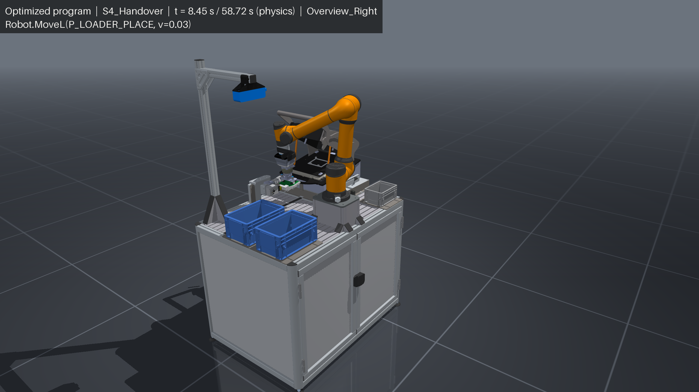
</p>

**Figure 2:** The cell during the handover in the Optimized program (physics run, t = 8.45 s): the robot places the PCB into
the loader's jaws in front of the MG06 tester. Rendered from the simulation model.

<details>
<summary><b>The robot points</b>: the cell posed at each of the 25 named points</summary>

<p align="center">
  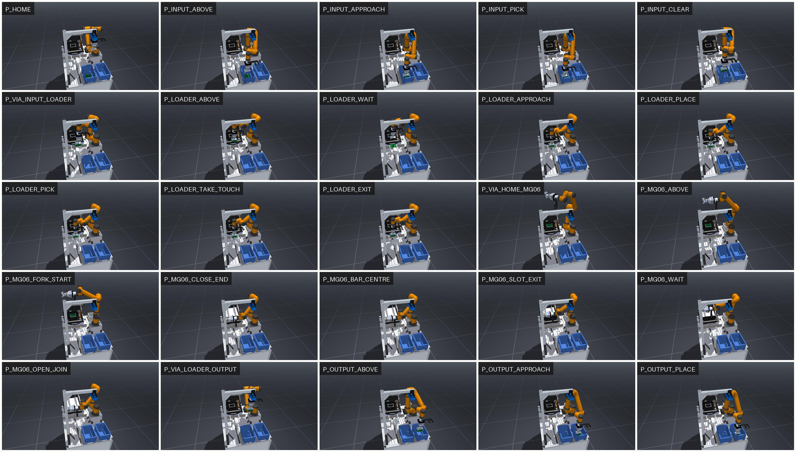
</p>

**Figure 3:** The cell posed at every robot point of `Configuration/Constants.yaml`, in program order, with the loader,
jaws, PCB and MG06 in each point's scene. Rendered from the simulation model.

</details>

## How the model was built

**From CAD to MuJoCo.** The workstation, the MG06 fixture, the loader and the PCB were exported from KINALI's CAD through
Blender into `models/scene.xml` in the predecessor projects (`mg06_loader_mujoco`, `mg06_cell_mujoco`). That scene is
finished and is never regenerated. The AUBO i5 comes from [ian-chuang/Manipulator-Mujoco](https://github.com/ian-chuang/Manipulator-Mujoco)
(MIT), the VGC10 with the fork from the MG06 project. `src/Scene/Core.py` assembles the cell at load time with `mujoco.MjSpec`
and changes nothing on disk: the tool mounted rigidly on the flange, one body with a bellows spring and an adhesion actuator
per suction cup, the robot's position servos, the loader's drive lag and the studio look.
`Example/Scene/export_cell_scene.py` writes the assembled cell as one file, `models/cell_scene.xml`.

**Collision geometry.** Every part has its own collision set, separate from its visual meshes: simplified and convex-part
meshes in `models/<part>/assets/collision/` and primitives (the crates as a floor and four walls, the PCB as a board box,
two corner strips and one component box, each cup as a square pad of its area). The kinematic checks use a planning model
that adds the table top as two boxes. The physics model has no table.

**Documented CAD deviations.** Three deliberate corrections in `models/scene.xml` make the cycle work in the model: the
loader shifted +100 mm in Y and +0.95 mm in X, the rear-right holder support lowered by 0.8 mm, and the electrical cabinet
200 mm deep instead of 300 mm. They must be checked against the real cell before any transfer.

**Physics and dynamics from the datasheets.** The parameters come from the components' datasheets where a datasheet gives
them. Where it does not, the value is an estimate or an assumption and is labelled as one:

| Component | What the model uses | Source |
|---|---|---|
| AUBO i5 | joint speeds 220 deg/s (J1-J4), 230 deg/s (J5-J6), both programs at 60 % | AUBO i5 datasheet |
| AUBO i5 | joint accelerations 3 rad/s² (J1-J3), 6 rad/s² (J4-J6) | assumption (not in the datasheet) |
| AUBO i5 | torque limits 180/180/150/60/60/60 N m, armature, servo gains | estimates (AUBO publishes neither) |
| OnRobot VGC10 | 4 cups of 15 mm, 40 kPa vacuum (datasheet range 20-60 %), so 7 N per touching cup | OnRobot VGC10 datasheet |
| SCHUNK EGI 040-EI | 40 mm stroke per jaw, 70 N grip (datasheet 25-70 N), jaws synchronized, at most 100 mm/s | SCHUNK product page and data sheet, ID 1474382 |
| Loader axes QF12 S420 (Y) and S300 (Z) | strokes from the CAD model, 30 ms drive lag, carriage masses 4 kg and 1.6 kg, move times of the reference plan | the CAD model, masses estimated |
| MG06 | lid gas springs, handle toggle with its dead point at about 31°, press plate coupled to the handle, lock with 1.5 mm play | modelled from the mechanism |
| PCB | 120 x 85 x 1.8 mm, 60 g | the part |

The solver runs at a 0.5 ms timestep (Newton solver, elliptic friction cones). These physics values are verified and pinned
by the model's fingerprint and the physics baselines (see [Verification](#verification)).

**Main limitations.** What the simulation does not model or has not verified:

- **No real-cell validation exists yet.** The pose convention (roll, pitch, yaw), the pendant's TCP setting, each joint's
  zero, direction and order, and the robot base pose are not compared with the AUBO controller. A point copied to the
  controller could command a different pose.
- **`MoveSpline`**, which the Optimized program uses, is not verified on the AUBO controller (streamed joint targets or
  blended MoveJ differ in path, timing and limits).
- **The loader gripper** is modelled from the datasheet (70 N, synchronized jaws, 100 mm/s). The real gripper's force and
  speed settings, its centring and the real release and re-grip heights are not verified.
- **The vacuum** is a constant force per touching cup: no leaks, no build-up, no holding range.
- **The fork closes MG06 through a stiff contact** whose force is chaotic (4 or 6 contact points, up to 247 N on the
  handle bar and a flange wrench of 239 N and 16.1 N m). The fork's bounds are regression bounds from the simulation. No
  force or moment rating of the VGC10 interface or the AUBO i5's flange and joints is known, so the real robot may deflect,
  trip its collision detection or overload the VGC10 although the run passes here.
- The acceleration limits are assumed, and the recorded MG06 fork paths exceed them.
- The MG06 test time is a 2.0 s placeholder, and the program's I/O ports are placeholders.
- The carried PCB's 20° tilt limit is an assumption. Cables are not modelled.

A first run on the real cell would go at reduced speed with the controller's own safety limits active, one moving object
at a time where possible: the loader jobs alone, then the robot's transfers alone with the loader parked, then the LOCKED
parts, then the parallel parts last, with the loader's `Loader.Start` / `Loader.WaitDone` handshake tested on its own first.

## Collision structure

<table>
  <tr>
    <td width="50%">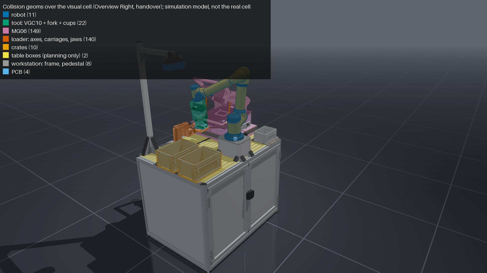
    <p><b>Figure 4:</b> The collision geoms over the visual cell during the handover, the whole cell.</p></td>
    <td width="50%">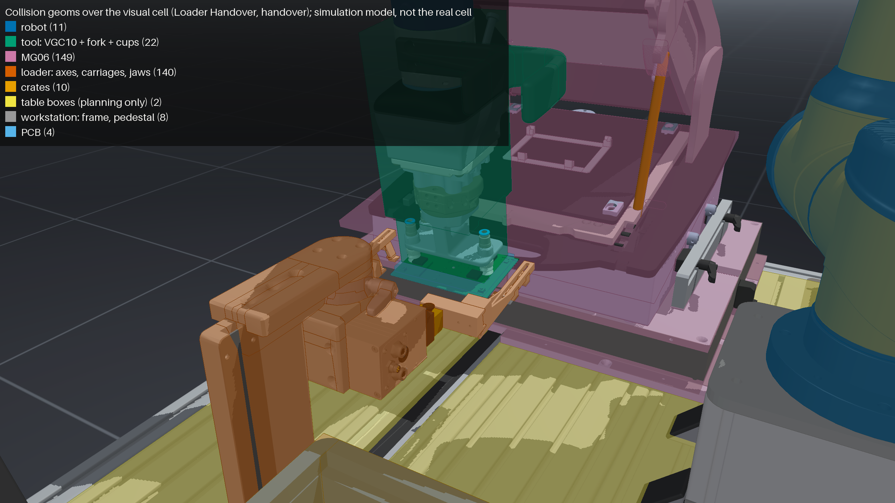
    <p><b>Figure 5:</b> The same at the loader handover, close up: the tool, the cups, the PCB and the loader's jaws.</p></td>
  </tr>
</table>

Each collision geom is blended semi-transparently in its category's colour over the rendered visual cell. The categories
and their geom counts, as in the images' legend:

| Category | Colour | Geoms |
|---|---|---:|
| robot | blue | 11 |
| tool: VGC10, fork and cups | bluish green | 22 |
| MG06 | reddish purple | 149 |
| loader: axes, carriages, jaws | vermillion | 140 |
| crates | orange | 10 |
| table boxes (planning model only) | yellow | 2 |
| workstation: frame, pedestal | grey | 8 |
| PCB | sky blue | 4 |

## Architecture

The code is in `src/`, one folder per domain, each with its primary module `Core.py`. A domain imports only the domains
below it:

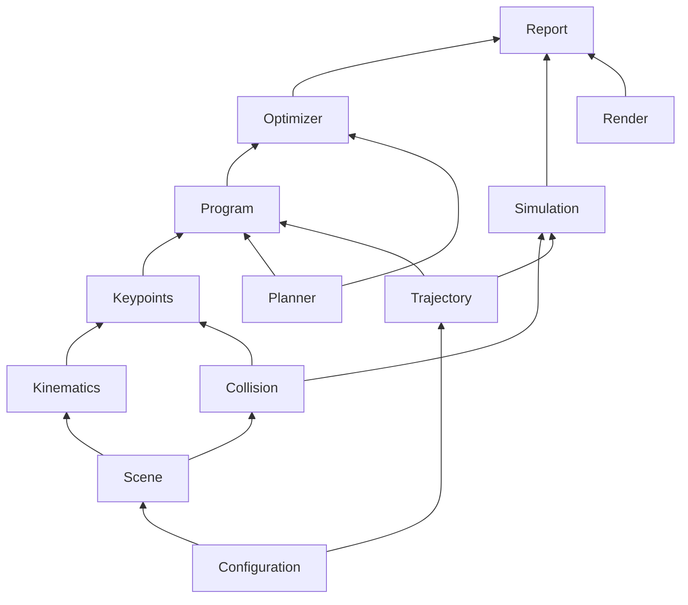

<details>
<summary><b>The domains and their roles</b>: what each folder of src/ does</summary>

| Domain | Role |
|---|---|
| Configuration | the only reader of the YAML files, the strict line parser of the cell program |
| Scene | builds the cell from the MJCF files, exports `models/cell_scene.xml` |
| Kinematics | site poses and inverse kinematics on the suction TCP or the flange |
| Collision | exact distances (`mj_geomDistance`), the planning model, the contact categories |
| Render | offscreen images and the passive viewer's playback loop |
| Trajectory | the 4 ms trajectory file (`.npz` and a CSV export) |
| Keypoints | the named robot points: posing, the point check, IK resolution |
| Program | builds a program into a trajectory and checks it (clearance, limits, interlocks) |
| Planner | RRT-Connect, shortcut, cubic spline and TOPP in joint space, independent of the cell |
| Optimizer | plans the Optimized program's free transfers and writes it |
| Simulation | the physics run of a trajectory, its report and the 28 acceptance checks |
| Report | the comparison of the two programs, its figures and media |

</details>

**The configuration files**, all in `Configuration/` and edited by hand. No tool writes them:

| File | Holds | Who changes it |
|---|---|---|
| `Program.yaml` | the program: segments of robot lines, the loader jobs | the robot programmer |
| `Constants.yaml` | the named values the program uses: points (stored joints), loader positions, gripper commands, signals | the robot programmer |
| `Simulation.yaml` | what only the simulation needs: allowed contacts per step, simulated signal times, the start state | the simulation maintainer |
| `Cell.yaml` | the cell's physical description: robot base, vacuum, clearances, motion limits, acceptance bounds | the simulation maintainer |
| `Optimization.yaml` | the optimizer's settings: FREE segments, seed, margins, exit and waiting points, tilt limit | the simulation maintainer |

`Data/Optimized/Program_Optimized.yaml` is the Optimized program. It is generated by `optimize_program.py` and committed.

**The data flow.** A program becomes a trajectory, the trajectory is run with physics, and the runs feed the reports:

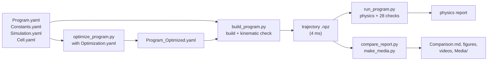

**The optimizer.** `Optimization.yaml` names the FREE segments: the free-space transfers between the process steps. Every
other segment is LOCKED: the picks, the handover, the fork paths at MG06, the take, the place and the loader jobs. A LOCKED
segment is copied unchanged from the Default program and its samples are byte-identical in both programs (only its start time
moves). Each FREE transfer is planned in four steps:

1. **RRT-Connect** in joint space finds a collision-free path (seeded, so the result is reproducible).
2. **Shortcut and prune** remove the detours.
3. **A cubic spline** is fitted through the remaining waypoints and **rechecked** in steps of at most 0.5° per joint, refitted
   where it comes too close.
4. **TOPP** (time-optimal path parametrization by reachability) times the spline within the speed and acceleration limits.

**Interlocks and the gating rule.** The robot and the loader move in parallel only where the program's order makes it safe.
Ten interlocks (I1-I10) are verified on every built trajectory, for example: the handover starts with the loader home and
open (I1), the robot goes to the take only after the loader's Y axis is home (I9), and the insert starts only after the robot
has left the handover (I10). The **gating rule** forbids any parallel part that rests on timing alone: while a loader job may
run, the robot stays at least 10 mm from every pose the job sweeps. The order must come from the program (the robot out of
the way before `Loader.Start`, or `Loader.WaitDone` before the robot moves in), never from a `Wait` or a quick start.

<details>
<summary><b>The ten interlocks</b>: what each one guarantees</summary>

| # | Interlock | Why |
|---|---|---|
| I1 | the handover starts with the loader home and the gripper open | the PCB enters open jaws |
| I2 | `J_INSERT`'s first loader move after the handover ends | the loader moves only after the robot left the jaw zone |
| I3 | MG06 is closed only after `J_PARK`'s last move (parked, gripper open) | the PCB is released and the loader parked |
| I4 | the test starts after the robot has left MG06 (closed, fork out of the bar) | the tester runs closed, the robot away |
| I5 | the robot returns to MG06 only after the test ends | no motion at MG06 during the test |
| I6 | `J_FETCH` starts after MG06 is open and the fork has left the handle | the loader enters MG06 only when it is open |
| I7 | the take starts after `J_RETURN_Z`'s last move (loader home, PCB clamped) | the robot enters the jaw zone only with the loader home |
| I8 | the robot and a carried PCB stay at least 10 + 4 mm from the loader where both may move | parallel motion is safe only where it is checked |
| I9 | the robot's motion to the take starts after `J_RETURN_Y` is done | the loader's Y is home, whatever the loader's speed |
| I10 | `J_INSERT` starts after the robot's motion out of the handover is done | the robot has left, whatever the robot's speed |

</details>

## Quick start

Prerequisite: Python 3.11. macOS (verified, Apple silicon): `brew install python@3.11`. Ubuntu (not verified):
`sudo apt install python3.11 python3.11-venv`.

```bash
git clone https://github.com/rparak/KINALI_Test_it_off_Simulation.git
cd KINALI_Test_it_off_Simulation
./install.sh                                         # .venv with Python 3.11 and the pinned requirements, about 20 s
.venv/bin/python Example/Program/build_program.py    # the Default program -> trajectory + kinematic check
.venv/bin/python Example/Simulation/run_program.py   # its physics run and the 28 acceptance checks, about 20 s
```

The last command ends with:

```text
Program: the physics run meets SPEC §10.1 (28 of 28). Simulation results only: not validated for the real cell.
```

On macOS the viewer scripts run under `.venv/bin/mjpython` (MuJoCo's passive viewer needs it). Under `.venv/bin/python`
they exit with code 2 and name the `mjpython` command.

## Usage

The scripts are in `Example/`. Each writes its outputs into `Data/Generated/<Kind>/` (git-ignored) and its log into `logger/`.
In the options, `taught` / `default` selects the Default program and `optimized` the Optimized program.

**Build and optimize the programs.**

```bash
.venv/bin/python Example/Program/build_program.py                                                  # Default program: trajectory + check report
.venv/bin/python Example/Program/optimize_program.py                                               # writes Data/Optimized/Program_Optimized.yaml, about 60 s
.venv/bin/python Example/Program/build_program.py --program Data/Optimized/Program_Optimized.yaml  # Optimized program: trajectory + check report
```

`build_program.py` prints the check report and exits 1 when the kinematic check fails.

**Watch a program (kinematic).**

```bash
.venv/bin/mjpython Example/Program/show_program.py                       # play the Default program in the viewer
.venv/bin/mjpython Example/Program/show_program.py --version optimized   # play the Optimized program
.venv/bin/python Example/Program/show_program.py --step S11_Test --headless --image   # pose the end of a step, write an image
```

Keys: Home pause / resume, Page Down or `.` next step, Page Up step start / previous step, End step end. In the MuJoCo viewer
`[` and `]` switch between the cameras `cam_pcb` and `cam_tool`.

**Run a program with physics.**

```bash
.venv/bin/python Example/Simulation/run_program.py --program optimized       # physics report + 28 checks; exit 0 pass, 1 fail, 2 cannot run
.venv/bin/mjpython Example/Simulation/show_physics.py --program optimized    # the physics run in the viewer, real time
.venv/bin/mjpython Example/Simulation/show_physics.py --speed 0.25           # slow motion
.venv/bin/python Example/Simulation/show_physics.py --headless --time 20 --image   # run to 20 s, print the state, write an image
```

Keys: Home pause / resume, Page Down next step, `.` one sample on (paused), End step end. A physics run goes forward only.

**Check and resolve the robot points.**

```bash
.venv/bin/python Example/Keypoints/check_keypoints.py                          # the point table: IK, family, clearance; exit 1 on a FAIL
.venv/bin/python Example/Keypoints/resolve_keypoint.py --name P_LOADER_WAIT    # prints the corrected Joints line to paste into Constants.yaml
.venv/bin/mjpython Example/Keypoints/show_keypoint.py --name P_LOADER_PLACE    # the cell posed at one point
.venv/bin/mjpython Example/Keypoints/step_keypoints.py                         # step through the points: Page Down / Page Up
```

**Compare the programs and render the media.**

```bash
.venv/bin/python Example/Report/compare_report.py                # Comparison.md + 7 figures (dark and light), about 80 s
.venv/bin/python Example/Report/compare_report.py --media Media  # also the README's summary chart and timeline
.venv/bin/python Example/Report/make_media.py                    # videos, GIF previews, view, point and collision images
.venv/bin/python Example/Program/compare_programs.py             # a quick kinematic table and figure of both programs
```

`compare_report.py` writes `Data/Generated/Reports/Comparison/`. `make_media.py` writes the full media there (MP4 videos
at 1080p and 1440p, the 2 x 2 mosaics, the event clips, every named view) and the README's previews and images into
`Media/`. `--program`, `--views`, `--until` and the `--skip-*` options limit what it renders.

**Run the tests and the regression baselines.** Two tiers (times on an Apple M2 Pro):

```bash
.venv/bin/python -m pytest -n 8 -m "not slow"                  # per commit, about 45 s
.venv/bin/python Example/Scene/model_fingerprint.py           # the compiled model vs its baseline: 1 difference expected (the PCB colour)
.venv/bin/python Example/Program/golden_program.py            # the Default program vs its golden data: 0 differences
.venv/bin/python -m pytest -n 8                                # per accepted change: the full suite, about 5 min
.venv/bin/python Example/Simulation/physics_baseline.py       # both programs vs their physics baselines: 0 failures
```

**What to regenerate after an edit.** The scripts detect stale inputs: every trajectory records the sha256 of the files it was
built from, and the Optimized program records its inputs and the planning model.

| You edited | Then run | Stale detection |
|---|---|---|
| `Constants.yaml` (a point) | `resolve_keypoint.py --name <P>`, paste the line, then `check_keypoints.py` | the point check reports a stale derived point |
| `Program.yaml`, `Constants.yaml`, `Simulation.yaml`, `Cell.yaml` | `build_program.py`, then `optimize_program.py` and its build | the viewers and the physics run refuse a stale trajectory |
| `Optimization.yaml` | `optimize_program.py`, then `build_program.py --program Data/Optimized/Program_Optimized.yaml` | the build refuses a stale Optimized program |
| any of the above, for the comparison | `compare_report.py --media Media`, then `make_media.py` | both refuse stale trajectories |

## Default vs Optimized program

All numbers are simulation results from `compare_report.py` on the committed programs: **[K]** the kinematic trajectory,
**[P]** the physics run.

| Metric | Default program | Optimized program | Change |
|---|---:|---:|---:|
| Cycle time [s] [K] | 70.404 | 59.148 | −16.0 % |
| Throughput [PCB/h] [K] | 51.1 | 60.9 | +19.0 % |
| TCP arc length [m] [K] | 7.96 | 7.35 | −7.7 % |
| Joint-space arc length [rad] [K] | 32.4 | 27.5 | −15.0 % |
| PCB arc length [m] [K] | 2.71 | 2.86 | +5.5 % |
| Closest robot - loader in a free transfer [mm] [P] | 20.0 | 15.6 | — |
| Closest robot - loader overall, at the take [mm] [P] | 8.30 | 8.30 | equal |
| Largest carried PCB tilt [deg] [P] | 9.0 | 16.8 | — |
| Largest PCB slip in the cups [mm] [P] | 1.30 | 1.31 | — |
| Acceptance checks [P] | 28/28 pass | 28/28 pass | equal |

Throughput = 3600 s / cycle time. The joint-space arc length sums the norm of the six joints' change over the 4 ms samples.

**Key findings.**

- **The gain comes from parallel motion and planned transfers.** The robot moves while the loader inserts, parks, fetches
  and returns the PCB, and the planned splines replace the taught vias. Of the 11.256 s saved, 6.940 s is robot motion and
  4.316 s is robot waiting for the loader. The LOCKED process steps are identical in both programs.
- **No parallel part rests on timing.** Because every parallel part is gated by the program's order, the Optimized program
  keeps I8 for any loader job slowed down up to 2 x and for any robot speed override down to 10 %: the closest robot - loader
  distance stays 29.68 mm. A slower loader or a slower robot only lengthens the cycle.
- **The gate costs 0.432 s.** The robot first moves to its exit point `P_LOADER_WAIT` and only then starts the insert, which
  lengthened the cycle from 58.716 s to 59.148 s (+0.7 %).
- **The longer PCB path is accepted.** The optimization minimizes the cycle time, not the PCB path: the +5.5 % PCB arc comes
  from joint-space planning, the clearance kept around the loader and the larger tilt.

<p align="center">
  <picture>
    <source media="(prefers-color-scheme: dark)" srcset="Media/Default_vs_Optimized_dark.png">
    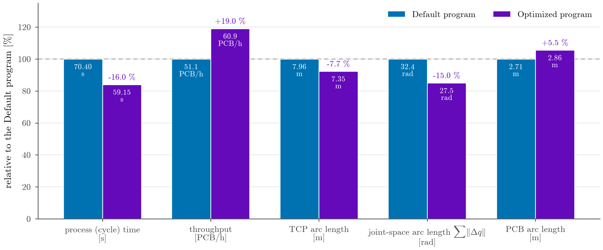
  </picture>
</p>

**Figure 6:** Default vs Optimized: the Optimized program relative to the Default program (100 %), with each value and its
change. Throughput = 3600 s / cycle time. All values from the kinematic trajectories [K]. Simulation results.

<p align="center">
  <picture>
    <source media="(prefers-color-scheme: dark)" srcset="Media/Timeline_dark.png">
    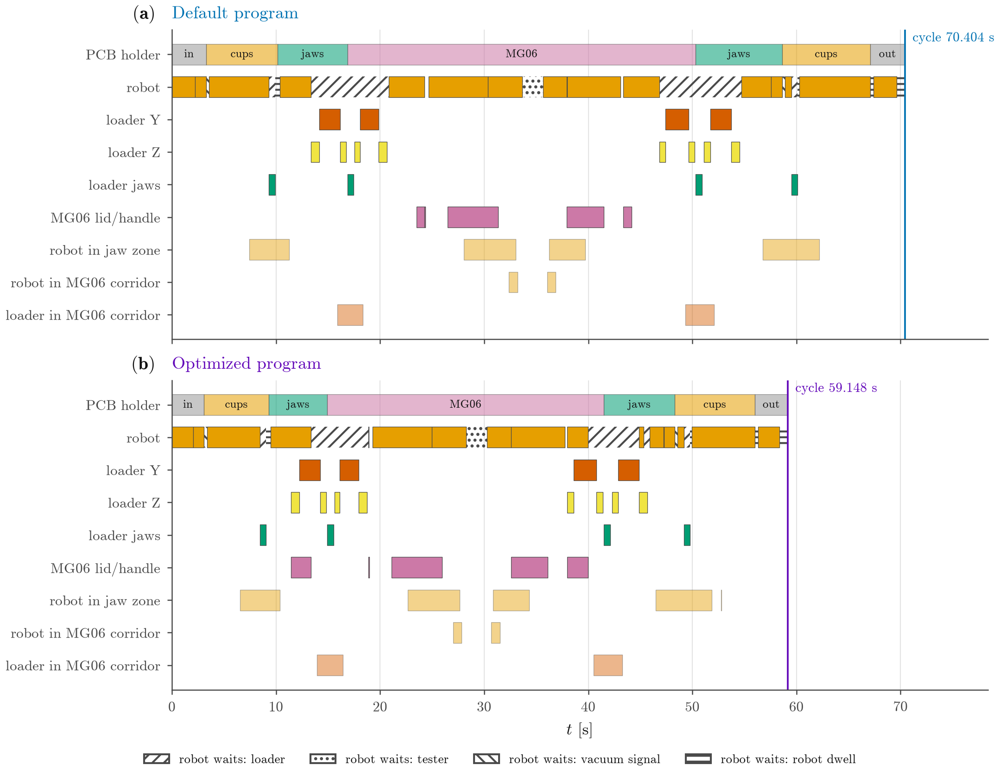
  </picture>
</p>

**Figure 7:** The timeline of every moving object in both programs: who holds the PCB, when the robot moves or waits (hatched
by what it waits for), the loader axes and jaws, MG06, and when the robot or the loader is in a shared zone. In the
Optimized program the loader rows overlap the robot's motion. Kinematic trajectories.

<p align="center">
  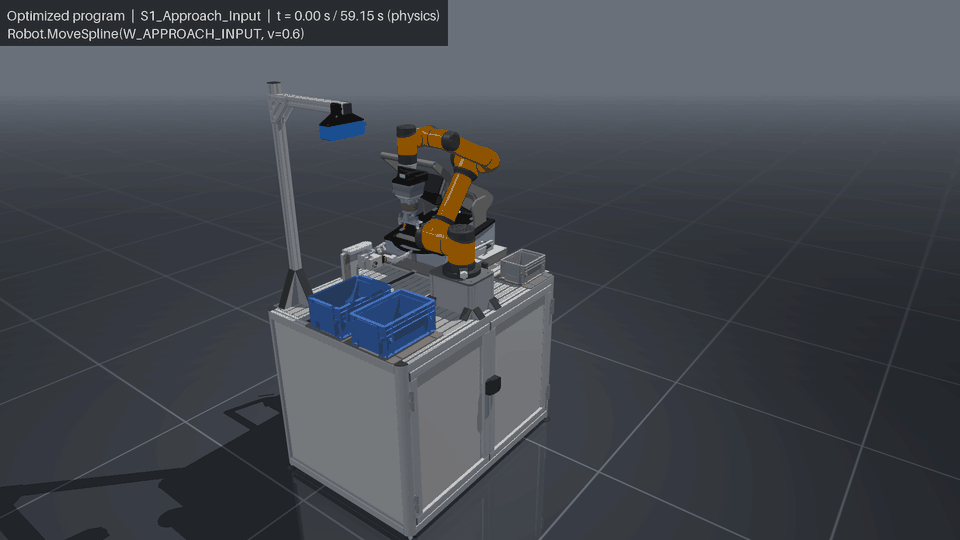
</p>

**Figure 8:** The Optimized program's cycle in physics, Overview_Right view, at 4 x speed.

The full-resolution videos (MP4, H.264, real time) are assets of the
[v1.0 release](https://github.com/rparak/KINALI_Test_it_off_Simulation/releases/tag/v1.0): the two programs side by side
([`Default_vs_Optimized_Side_by_Side.mp4`](https://github.com/rparak/KINALI_Test_it_off_Simulation/releases/download/v1.0/Default_vs_Optimized_Side_by_Side.mp4)), each program in the Overview_Right view
([`Default_Overview_Right_1440p.mp4`](https://github.com/rparak/KINALI_Test_it_off_Simulation/releases/download/v1.0/Default_Overview_Right_1440p.mp4),
[`Optimized_Overview_Right_1440p.mp4`](https://github.com/rparak/KINALI_Test_it_off_Simulation/releases/download/v1.0/Optimized_Overview_Right_1440p.mp4)) and as a 2 x 2 mosaic
([`Default_Mosaic_1440p.mp4`](https://github.com/rparak/KINALI_Test_it_off_Simulation/releases/download/v1.0/Default_Mosaic_1440p.mp4),
[`Optimized_Mosaic_1440p.mp4`](https://github.com/rparak/KINALI_Test_it_off_Simulation/releases/download/v1.0/Optimized_Mosaic_1440p.mp4)).
`make_media.py` writes them locally.

<details>
<summary><b>The stations close up</b>: the crates, the loader handover and MG06</summary>

<table>
  <tr>
    <td width="50%">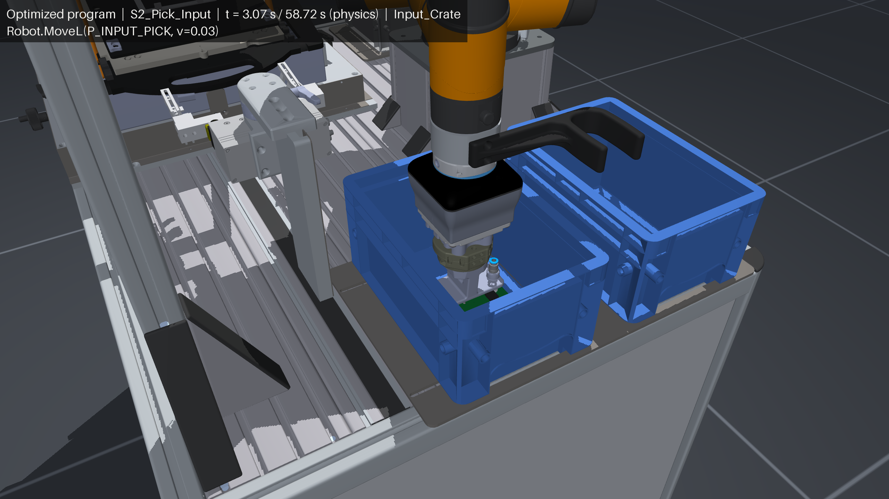
    <p><b>Figure 9:</b> The input crate: the pick with four suction cups.</p></td>
    <td width="50%">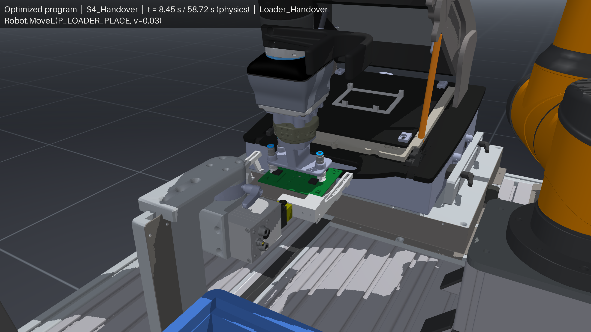
    <p><b>Figure 10:</b> The loader handover: the PCB placed into the open jaws, tilted 8.94° like the cassette.</p></td>
  </tr>
  <tr>
    <td width="50%">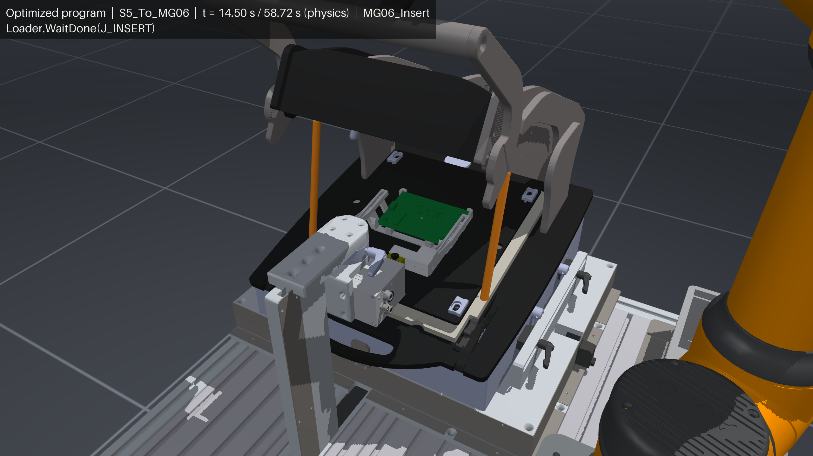
    <p><b>Figure 11:</b> MG06: the loader has released the PCB into the holder, 0.15 mm above its seat.</p></td>
    <td width="50%">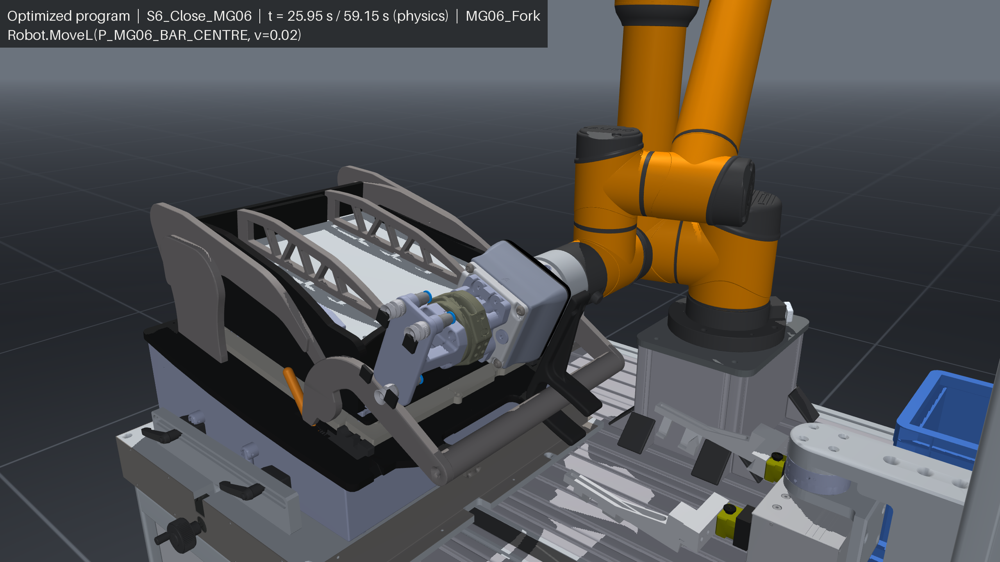
    <p><b>Figure 12:</b> MG06: the fork on the handle bar after closing the fixture, before it leaves for the test.</p></td>
  </tr>
  <tr>
    <td width="50%">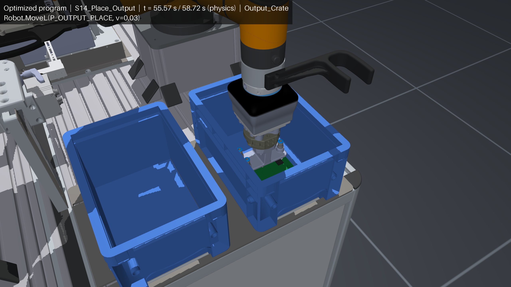
    <p><b>Figure 13:</b> The output crate: the place, the PCB released 1 mm above the floor.</p></td>
    <td width="50%"></td>
  </tr>
</table>

All close views are from the Optimized program's physics run, rendered from the simulation model.

</details>

## Verification

**The acceptance checks.** A physics run passes when all 28 checks pass. Both programs pass 28 of 28. They cover the
contacts, the PCB's custody and placement, the robot's tracking and loads, the room around the loader and the place into MG06.

<details>
<summary><b>The 28 checks</b>: grouped, with their bounds</summary>

| Group | Checks |
|---|---|
| Contacts | no robot contact with MG06, the workstation, the crates or the loader, the tool on the handle only while closing and opening, no loader contact with MG06, the PCB never on the lid or the press plate (5) |
| The PCB | 4 of 4 cups at both picks and in every hold, never lost, in MG06 within 0.5 mm and 0.2°, in the output crate within 2 mm of the centre, penetration at most 0.5 mm, slip at most 1.98 mm (7) |
| The cell | MG06 ends open, every vacuum signal in time, the robot tracking within 0.0189 rad, no actuator saturated, the fork's force and the handle load within their simulation bounds (6) |
| The loader | the free transfers at least 1 mm and 10 mm from the loader (2) |
| The place into MG06 | the jaws only open, no press on the holder, the drop and settled penetrations, no side guide touched, the PCB seated within 0.2 s, the handover centring, the re-grip gap (8) |

</details>

**The regression baselines.** Each program's physics run is compared with its baseline in `test/Simulation/data/`. A run
fails on any acceptance check and on a metric beyond its drift tolerance: the cycle time exact, the vacuum events ±4 ms,
the PCB's placed and final positions ±0.05 mm, the tracking error and the joint torques ±10 %, the closest loader distance
±0.5 mm. The fork's contact with the handle bar is chaotic, so its force, the handle load and two joint torques are compared
with an envelope over 10 slightly perturbed runs per program, ±10 %. The compiled model is pinned by its fingerprint and the
Default program's build by its golden data.

**Robustness to timing.** The Optimized program's parallel jobs, slowed or with the robot slowed, measured on the kinematic
trajectory (closest robot - loader distance over each job, the loader where its actuators put it):

| Lane slowed | Range tried | Closest distance [mm] | First failure of I8 (14 mm), 10 mm, 1 mm, contact |
|---|---|---:|---|
| a loader job | 0.5 x to 2 x as long | 29.68 | none |
| the robot (speed override) | 100 % down to 10 % | 29.68 | none |

<details>
<summary><b>The stretch tables</b>: the closest distance per job, loader slowed and robot overridden</summary>

Each loader job slowed by a factor, the robot as programmed (`> 50 mm`: farther than 50 mm):

| Factor | J_INSERT | J_PARK | J_FETCH [mm] | J_RETURN_Y [mm] | J_RETURN_Z |
|---:|---|---|---:|---:|---|
| 0.50 | > 50 mm | > 50 mm | 47.20 | 29.68 | > 50 mm |
| 0.75 | > 50 mm | > 50 mm | 34.87 | 29.68 | > 50 mm |
| 0.90 | > 50 mm | > 50 mm | 29.68 | 29.68 | > 50 mm |
| 1.00 | > 50 mm | > 50 mm | 29.68 | 29.68 | > 50 mm |
| 1.02 | > 50 mm | > 50 mm | 29.68 | 29.68 | > 50 mm |
| 1.05 | > 50 mm | > 50 mm | 29.68 | 29.68 | > 50 mm |
| 1.10 | > 50 mm | > 50 mm | 29.68 | 29.68 | > 50 mm |
| 1.25 | > 50 mm | > 50 mm | 29.68 | 29.68 | > 50 mm |
| 1.50 | > 50 mm | > 50 mm | 29.68 | 29.68 | > 50 mm |
| 2.00 | > 50 mm | > 50 mm | 29.68 | 29.68 | > 50 mm |

The robot slowed by a speed override, each job as programmed:

| Override | J_INSERT | J_PARK | J_FETCH [mm] | J_RETURN_Y [mm] | J_RETURN_Z |
|---:|---|---|---:|---:|---|
| 10 % | 47.85 mm | > 50 mm | 47.20 | 29.68 | > 50 mm |
| 25 % | > 50 mm | > 50 mm | 47.20 | 29.68 | > 50 mm |
| 50 % | > 50 mm | > 50 mm | 47.20 | 29.68 | > 50 mm |
| 75 % | > 50 mm | > 50 mm | 35.26 | 29.68 | > 50 mm |
| 90 % | > 50 mm | > 50 mm | 29.68 | 29.68 | > 50 mm |
| 100 % | > 50 mm | > 50 mm | 29.68 | 29.68 | > 50 mm |

</details>

## Repository layout

```text
Configuration/   the cell (Cell.yaml), the program (Program.yaml, Constants.yaml, Simulation.yaml), the optimizer (Optimization.yaml)
Data/            the PCB poses, the recorded MG06 fork path, the committed Optimized program; Generated/ (git-ignored outputs)
Example/         the scripts, one folder per domain: Scene, Render, Keypoints, Program, Simulation, Report, Media
Media/           the README's images, charts and GIF previews
models/          the MJCF files and meshes: scene.xml, the AUBO i5, the VGC10 with the fork, cell_scene.xml
src/             the library, one folder per domain (see Architecture)
test/            the tests, mirroring src/ and Example/, with the regression baselines in test/<Domain>/data/
install.sh       creates .venv with Python 3.11 and the pinned requirements
```

## Requirements and platform

- **Platform:** macOS on Apple silicon (verified, Apple M2 Pro) and Ubuntu Linux (installer written, not verified).
- **Python 3.11**, called explicitly by `install.sh` (`/opt/homebrew/bin/python3.11` on macOS, `python3.11` on Linux).
- **Pinned packages** (`requirements.txt`): `mujoco==3.16.0`, `numpy==2.4.6`, `scipy==1.17.1`, `PyYAML==6.0.3`,
  `matplotlib==3.11.2`, `pillow==13.0.0`, `imageio-ffmpeg==0.6.0`, `pytest==9.1.1`, `pytest-xdist==3.8.0`, and
  `trimesh`, `rtree`, `coacd` for a planned collision-set build.
- Results are byte-identical for the same inputs on one machine and platform. Across platforms they agree within numeric
  tolerance only.

## Citation

If you use this project, cite it with the metadata in [CITATION.cff](CITATION.cff). GitHub shows it as *Cite this repository*
on the repository page.

## License

MIT License, Copyright (c) 2026 JIC Smart Factory. See [LICENSE](LICENSE).

Third party:

- **AUBO i5 model**: from [ian-chuang/Manipulator-Mujoco](https://github.com/ian-chuang/Manipulator-Mujoco), MIT License
  ([models/aubo_i5/LICENSE_Manipulator-Mujoco](models/aubo_i5/LICENSE_Manipulator-Mujoco)).
- **imageio-ffmpeg** (BSD-2-Clause) is a tool dependency of the media scripts only. Its bundled ffmpeg 7.1 binary is a GPL
  build (GPL-2.0-or-later, with libx264 and libx265). The project runs it as a separate program and neither links nor
  redistributes it (pip installs it into `.venv`). No simulation, check or physics result depends on it.
- **Vendor datasheets** (AUBO i5, OnRobot VGC10, SCHUNK EGI 040-EI) are cited for the values the model takes from them. They
  are not included in this repository.
- Test-it-off is a product of KINALI and is referenced by name only.

## Authors

<table><tr><td align="center"><a href="https://github.com/rparak"><br /><strong>Roman Parak</strong></a><br />Author</td><td align="center"><a href="https://github.com/LukasMoravansky"><br /><strong>Lukas Moravansky</strong></a><br />Contributor</td></tr></table>
